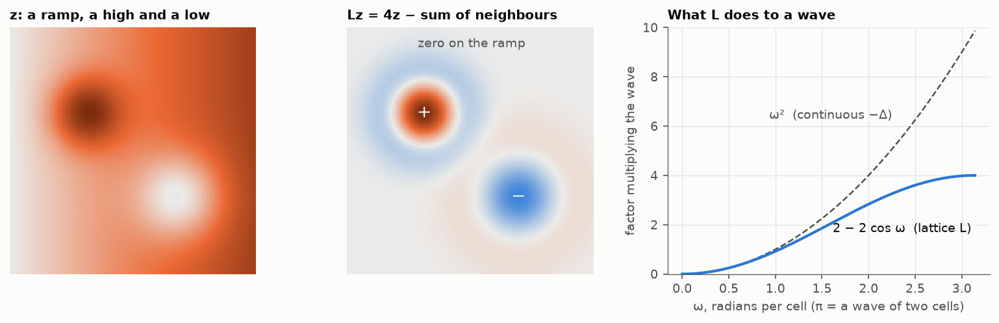

# 1. Neighbours

On a 2-D grid, the Laplacian `L` applied to a field `z` gives, at each cell,

```
(Lz)(i, j) = 4 z(i, j) − z(i−1, j) − z(i+1, j) − z(i, j−1) − z(i, j+1)
```

which is four times the difference between the cell and the average of its
four neighbours. As a stencil:

```
       −1
  −1    4   −1
       −1
```

In 1-D it is `2z(i) − z(i−1) − z(i+1)`, the second difference with the sign
changed; in 3-D the centre is 6 and there are six neighbours. This is the
discrete form of `−Δ = −(∂²/∂x² + ∂²/∂y²)`. The minus sign makes the matrix
positive semi-definite, which is what a precision matrix needs.



Three things to read from the figure:

- **It ignores levels and slopes.** On a constant or on a ramp, each cell
  already is the average of its neighbours, so `Lz = 0`. Only curvature
  survives: positive on the high, negative in the low, with a ring of the
  opposite sign where the surface flattens out.
- **`Lz = 0` means "equal to the average of the neighbours".** A field with
  that property everywhere is called harmonic. Chapter 5 shows that the
  kriging mean of the simplest model is harmonic between the data.
- **It amplifies short waves.** A wave of frequency `ω` comes out of `L` as
  the same wave multiplied by `2 − 2 cos ω` per axis, close to `ω²` for long
  waves. Waves are the eigenvectors of `L`. Dividing by that factor instead
  of multiplying damps short waves and keeps long ones, which is how a
  spatially correlated field is made from white noise (chapters 3 and 4).

`L` is also a matrix: one row per cell, with the stencil in it. It is
symmetric, its rows sum to zero, and it has 5 non-zero entries per row out of
as many columns as there are cells.

## Checked by

`tests/test_theory.py`: `test_laplacian_is_cell_minus_neighbours`,
`test_laplacian_ignores_constants_and_ramps_and_sees_curvature`,
`test_waves_are_eigenvectors`.

Next: [the screen effect](../02-screen-effect/).
