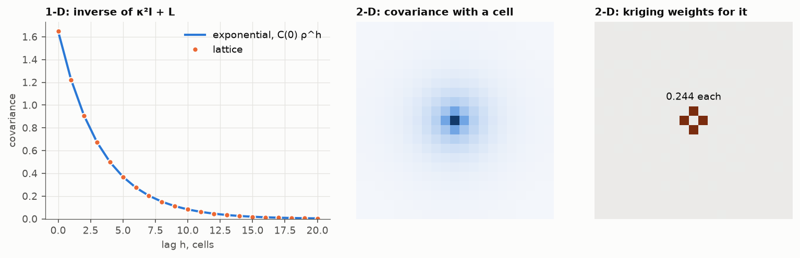

# 2. The screen effect

A Gaussian field can be described by its covariance matrix `C` or by its
inverse, the precision matrix `Q = C⁻¹`. They hold different information:

- `C(i, j)` says how cells `i` and `j` vary together, whatever lies between
  them. The variogram is this, read by lag.
- `Q(i, j)` says how `i` and `j` are related **once all the other cells are
  known**. The row of `Q` at a cell is the simple kriging system of that cell
  from every other cell, already solved:

```
weight of cell j on cell i   = −Q(i, j) / Q(i, i)
kriging variance of cell i   = 1 / Q(i, i)
```

A zero in `Q` is a sample that is completely screened.

## The model

Take `Q = τ(κ² I + L)`, with `L` the Laplacian of chapter 1. The row of a
cell holds `τ(κ² + 4)` on the diagonal and `−τ` at each of the four
neighbours, so

```
estimate of a cell from all others = (sum of the four neighbours) / (4 + κ²)
kriging variance                   = 1 / (τ (4 + κ²))
```

Nothing beyond the four neighbours has any weight, no matter how strongly it
is correlated with the cell.



Left: in 1-D the model is `2 + κ²` on the diagonal and `−1` beside it. Its
inverse is *exactly* the exponential covariance `C(0) ρ^h`, with `ρ` the
smaller root of `ρ² − (2 + κ²)ρ + 1 = 0`. With `κ = 0.3`, `ρ = 0.742`: a
scale parameter of 3.35 cells and a practical range of about 10. This is the
known fact that the exponential model in 1-D has a perfect screen effect: the
two adjacent samples carry all the weight.

Centre and right: in 2-D with `κ = 0.3`, the covariance of a cell reaches
across the grid, but kriging that cell from the 440 others with the dense
covariance gives 0.244 on each of the four neighbours and zero, to machine
precision, on the rest. The kriging system recovered the stencil.

The weights sum to `4/(4 + κ²)`, a little under one. The rest,
`κ²/(4 + κ²)`, is the weight of the mean in simple kriging. So `κ²` is how
hard each cell is pulled back to the mean: large `κ`, short range. Chapter 6
takes it to zero.

## Checked by

`test_one_dimensional_precision_is_the_exponential_covariance`,
`test_kriging_weights_are_the_stencil`,
`test_kappa_squared_is_the_weight_of_the_mean`.

Next: [which variogram](../03-which-variogram/).
