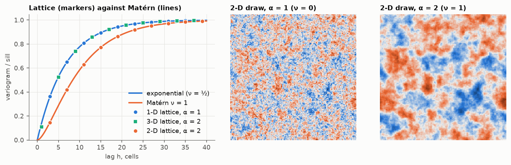

# 3. Which variogram

Chapter 2 chose a precision and found the exponential model in 1-D. The
general rule (Whittle, 1954; Lindgren et al., 2011) is

```
precision  τ (κ² − Δ)^α  in d dimensions
    =  Matérn covariance with  ν = α − d/2,
       sill  σ² = Γ(ν) / ( Γ(α) (4π)^(d/2) κ^(2ν) τ )
```

The reason is in the last panel of chapter 1. A wave of frequency `ω` is an
eigenvector of the precision with eigenvalue `τ(κ² + |ω|²)^α`, so its
variance is `1 / (τ(κ² + |ω|²)^α)`, and that is the spectral density of the
Matérn model. Each parameter has a job:

- `κ` decides where the spectrum stops being flat. Waves much longer than
  `1/κ` all get the same variance: beyond that distance there is no more
  structure, which is a sill. Practical range (95 % of the sill): `3.0/κ` for
  `ν = ½`, `4.0/κ` for `ν = 1`, `4.7/κ` for `ν = 3/2`.
- `α` decides how fast short waves are suppressed, which is the behaviour of
  the variogram at the origin: linear for `ν = ½`, nearly parabolic for
  `ν = 1` and above.
- `τ` scales everything: the sill.

| d | α | ν | Model |
| --- | --- | --- | --- |
| 1 | 1 | ½ | exponential |
| 1 | 2 | 3/2 | Matérn 3/2 |
| 2 | 1 | 0 | no point-support sill (see below) |
| 2 | 2 | 1 | Matérn 1, Whittle's model |
| 3 | 1 | −½ | no point values at all, only block averages |
| 3 | 2 | ½ | exponential |



Left: variograms of the lattice model with `κ = 0.15`, computed exactly,
against the Matérn curves. The 1-D model with one Laplacian and the 3-D model
with two fall on the same exponential curve. The agreement is within 1 % in
1-D and 3 % in 2-D for `κ = 0.2`; in 3-D the lattice is up to 7 % above at
the first lags, where a cell is not a point.

## The case ν = 0

Centre panel: one Laplacian in 2-D gives a field that looks like noise with
some structure. Its covariance is `K₀(κh)/(2πτ)`, which is infinite at
`h = 0`: there is no variance at point support. The lattice value is finite
only because a cell has a size, and it grows by `ln 2 / (2πτ)` every time
`κ` is halved, that is, every time the cell is halved relative to the range.
The variance depends on the support, logarithmically. This is the de Wijsian
model, and chapter 6 returns to it.

For a field with a sill that does not depend on the cell size, use `α = 2`
in 2-D and 3-D.

## Checked by

`test_lattice_covariance_is_matern` (1-D, 2-D, 3-D),
`test_two_dimensional_alpha_one_has_no_sill_of_its_own`.

Next: [simulation](../04-simulation/).
