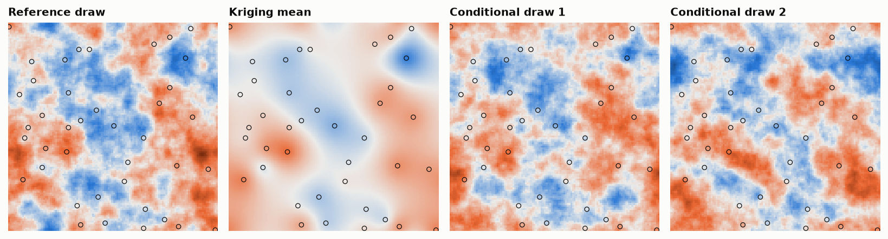

# 4. Simulation

A draw of the model is white noise passed through `Q^(−1/2)`. There are
three ways to do it, all of them the Laplacian.

**In Fourier space.** Transform white noise, divide each wave by
`√(τ(κ² + λ)^α)` with `λ` the eigenvalue of `L` for that wave, transform
back. Exact on a torus, any `α`, including fractions. `simulate_spectral`.

**By solving an equation.** If `A z = w` with `w` white noise, then `z` has
covariance `A⁻¹A⁻ᵀ` and precision `AᵀA`. With `A = κ² I + L` the precision
is `(κ² I + L)²`, the model with `α = 2`. So one sparse solve of

```
(κ² I + L) z = w / √τ
```

is a draw of a Matérn field. This is the discretised form of the SPDE
`(κ² − Δ) Z = W`, and it is the whole of the "SPDE approach": the field is
whatever, after subtracting the neighbours and adding `κ²` of itself, leaves
white noise. No covariance matrix is ever built, and the grid need not be a
torus. `simulate_spde`.

**Cell by cell.** Chapter 2 gave the distribution of a cell given all the
others: normal, with mean `(sum of neighbours)/(4 + κ²)` and variance
`1/(τ(4 + κ²))`. Redrawing every cell from it, again and again, is a Gibbs
sampler, and it converges to the model. It is sequential Gaussian simulation
with a neighbourhood of four that is exact rather than approximate, at the
price of many passes instead of one. This is the cellular automaton of
the `cellular-geostat` project. `relax`
with `rng`.

## Conditioning

With a covariance, conditioning to data is a kriging system. With a
precision it is a deletion. Split the cells into data `d` and unknown `u`:

```
z_u | z_d  is normal with  precision  Q_uu
                           mean       m_u = −Q_uu⁻¹ Q_ud z_d
```

The conditional precision is the same matrix with the data rows and columns
removed. The mean is the simple kriging estimate with a global
neighbourhood; the check below compares it with dense kriging and they agree
to 10 decimals.

A conditional draw is then an unconditional one plus the kriging of its
error at the data, as in any conditioning by kriging:
`z_c = z + m(z_d − z at the data)`.



A grid of 120 × 120 cells, `κ = 0.12` (range about 33 cells), 40 data taken
from the reference. Each panel is one or two sparse solves of a matrix with
at most 13 non-zero entries per row; the covariance matrix of the same grid
would have 207 million.

## Checked by

`test_conditioning_with_the_precision_is_simple_kriging`,
`test_draws_reproduce_the_variogram_and_the_data`,
`test_gibbs_rule_samples_the_model`.

Next: [estimation](../05-estimation/).
