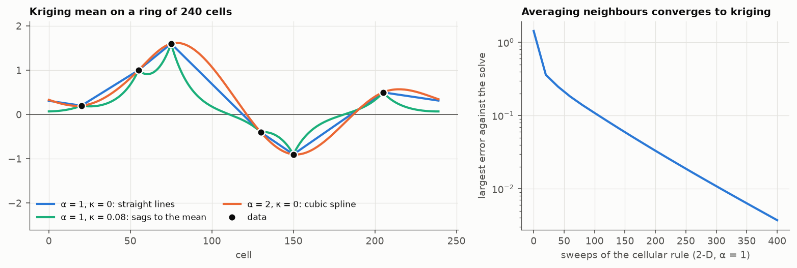

# 5. Estimation

The kriging mean of chapter 4 solves `Q_uu m_u = −Q_ud z_d`. Read row by
row, this says: **at every unknown cell, the precision applied to the
estimate is zero**,

```
((κ² I + L)^α m)(i) = 0     at every cell i without a datum
m(i) = z(i)                 at the data
```

So kriging is a boundary value problem. The data are the boundary and the
operator fills the space between them.



The left panel shows the three basic cases in 1-D, where they can be named:

- **`α = 1`, `κ = 0`: `Lm = 0`.** Laplace's equation. Each cell is the
  average of its two neighbours, so the estimate is a straight line between
  consecutive data. This is kriging with a linear variogram.
- **`α = 1`, `κ > 0`.** Each cell is a little less than the average of its
  neighbours, so away from the data the estimate sags to the mean, zero
  here. This is simple kriging with an exponential variogram, and the sag is
  the range.
- **`α = 2`, `κ = 0`: `L²m = 0`.** The estimate is the cubic spline through
  the data. In 2-D it is the thin-plate spline.

In 2-D the same statements hold with surfaces: `α = 1`, `κ = 0` gives the
harmonic surface, a soap film through the data.

## The same thing as a minimisation

The kriging mean is the field honouring the data that minimises `zᵀQz`.
Written out,

```
α = 1:   zᵀQz = τ ( κ² Σ z(i)²  +  Σ over links (z(i) − z(j))² )
α = 2:   zᵀQz = τ Σ ((κ² I + L) z)(i)²        κ = 0: total squared curvature
```

The first penalises slope and distance from the mean. The second, with
`κ = 0`, penalises curvature only, which is the definition of a spline. That
kriging and splines are the same computation is due to Matheron (1981) and
to Kimeldorf and Wahba (1970); here it is one line.

## Overshoot

With `α = 1` every cell is a weighted average of its neighbours with
positive weights, so the estimate can never leave the interval of the data
(and of the mean, when `κ > 0`). All kriging weights are non-negative.

With `α = 2` the row of the precision has 13 entries: the cell, `−2(4 + κ²)`
on the four neighbours, but `+2` on the four diagonals and `+1` two cells
away. Those are negative weights, and the estimate overshoots, as the orange
curve does past the highest datum. It is the usual trade: variograms that
are smooth at the origin give smooth maps, negative weights and estimates
outside the range of the data.

## Estimation as a cellular rule

Right panel: replace every unknown cell by `(sum of neighbours)/(4 + κ²)`,
repeat. That is the Gibbs sampler of chapter 4 with the noise removed, and
it converges to the kriging mean. It is also a heat equation run until it
settles. The number of sweeps grows with the square of the range, which is
why one solves the system directly, or uses multigrid, in practice.

## Checked by

`test_kriging_mean_minimises_the_energy`,
`test_relaxation_converges_to_the_kriging_mean`,
`test_alpha_one_never_overshoots_and_alpha_two_does`,
`test_one_dimension_gives_linear_interpolation_then_the_cubic_spline`.

Next: [no sill](../06-no-sill/).
