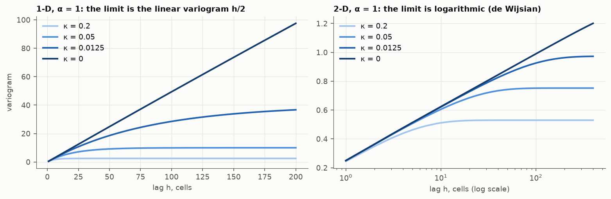

# 6. No sill

Chapter 2 found that `κ²/(4 + κ²)` is the weight of the mean. Set `κ = 0`.

The precision is then `τ L^α`, and the rows of `L` sum to zero. Three things
happen at once:

- **The weights sum to one.** The estimate of a cell from the others is the
  plain average of its neighbours. The mean has no weight, so it need not be
  known: this is ordinary kriging. Adding a constant to the data adds the
  same constant to the estimate.
- **The sill is gone.** The sill is proportional to `1/κ^(2ν)`, which is now
  infinite. `Q` is singular (it sends constants to zero), so there is no
  covariance matrix to invert it into.
- **The variogram is still there.** `Q` says nothing about the level of the
  field, but it gives every *difference* between cells a finite variance.
  That is the intrinsic hypothesis, and the model is defined by its
  variogram alone.

As `κ` falls the variograms climb to a longer range and a higher sill, and
at `κ = 0` what is left is

| d | α | Variogram of the limit | Known as |
| --- | --- | --- | --- |
| 1 | 1 | `h / 2τ` | linear; Brownian motion |
| 2 | 1 | `ln h / 2πτ` + constant | de Wijsian |
| 3 | 2 | proportional to `h` | linear |
| 1 | 2 | `h³` (generalised covariance) | cubic spline |
| 2 | 2 | `h² ln h` (generalised covariance) | thin-plate spline |

So the Laplacian alone, with nothing added, is the linear variogram in 1-D
and the de Wijsian model in 2-D. The last two rows are intrinsic random
functions of higher order (Matheron, 1973): in the continuum `Δ²` also
sends ramps to zero, so the estimate filters a linear drift, and the
generalised covariance takes the place of the variogram.

On the lattice the 2-D variogram rises by `ln 2 / 2π = 0.110` per doubling
of the lag, within 1 % from lag 4 on. On a ring of `n` cells the 1-D
variogram is exactly `h(n − h)/2n`, the linear variogram bent by the fact
that a ring closes on itself.

## Reading κ

`κ` is therefore the only thing separating simple from ordinary kriging, a
stationary model from an intrinsic one, and a sill from none. A small `κ`
says the data are trusted over the mean; `κ = 0` says there is no mean to
trust.

## Checked by

`test_limit_variograms`,
`test_intrinsic_estimate_does_not_see_a_shift_of_the_data`,
`test_kappa_squared_is_the_weight_of_the_mean`.

Next: [anisotropy and barriers](../07-anisotropy-and-barriers/).
