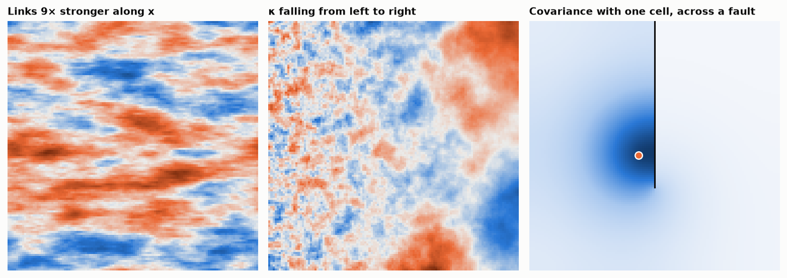

# 7. Anisotropy and barriers

So far every link between neighbours had weight one. The model is local, so
it can be changed locally, and each change has a meaning in variogram terms.

**Anisotropy: weight the links by direction.** With weight `w` on the links
along an axis the operator is `κ² − ∇·H∇` with `H = diag(w)`, and the range
along that axis is multiplied by `√w`. Left panel: 9 along x, range three
times longer. This is geometric anisotropy along the grid axes; a rotated
ellipse needs diagonal links as well (a 9-cell stencil), which this
repository does not build.

**A range that changes: let κ vary.** `κ` is one number per cell, so it can
be a map. Centre panel: `κ` falls from 0.6 to 0.06 from left to right, with
the noise scaled by `κ` to keep the sill constant. No positive-definiteness
has to be proved: any positive `κ` map and any positive link weights give a
valid model, because the precision stays symmetric and positive definite.
With a covariance function, a range that changes in space is a hard problem.

**Barriers: cut the links.** `L` is the Laplacian of a graph, and the graph
need not be a full grid. Right panel: the links crossing a fault are
removed. The covariance of a cell beside the fault does not cross it; it
goes round the end. Distance is measured along the links, with no need to
unfold anything. The same works for a domain of irregular shape, or for a
block model with holes.

## What it cannot do

- **Only Matérn.** Sparse precisions come from integer `α`. There is no
  spherical model, and no Gaussian model, with a sparse precision. Fractional
  `α` needs rational approximations.
- **Nugget.** A nugget is not a property of the field here; it is added as
  measurement noise on the data, which changes the conditioning equations of
  chapter 4. Not covered.
- **Data on cells.** The data sit on cell centres. Scattered data need a
  triangulated mesh and finite elements, which is what Lindgren et al. (2011)
  actually propose; the 5-cell stencil is its special case on a regular grid.
- **Borders.** At a no-flux border the variance rises: about double at an
  edge and four times at a corner for `α = 2`. Tori avoid it in these
  chapters; in practice one pads the grid by a range.
- **Reading the model.** A variogram can be fitted by eye to experimental
  points. `κ`, `α` and `τ` have to be converted, with the table of chapter 3.

## Checked by

`test_link_weights_stretch_the_range_by_their_square_root`,
`test_cutting_links_cuts_covariance`.

Back to the [overview](../../README.md).
